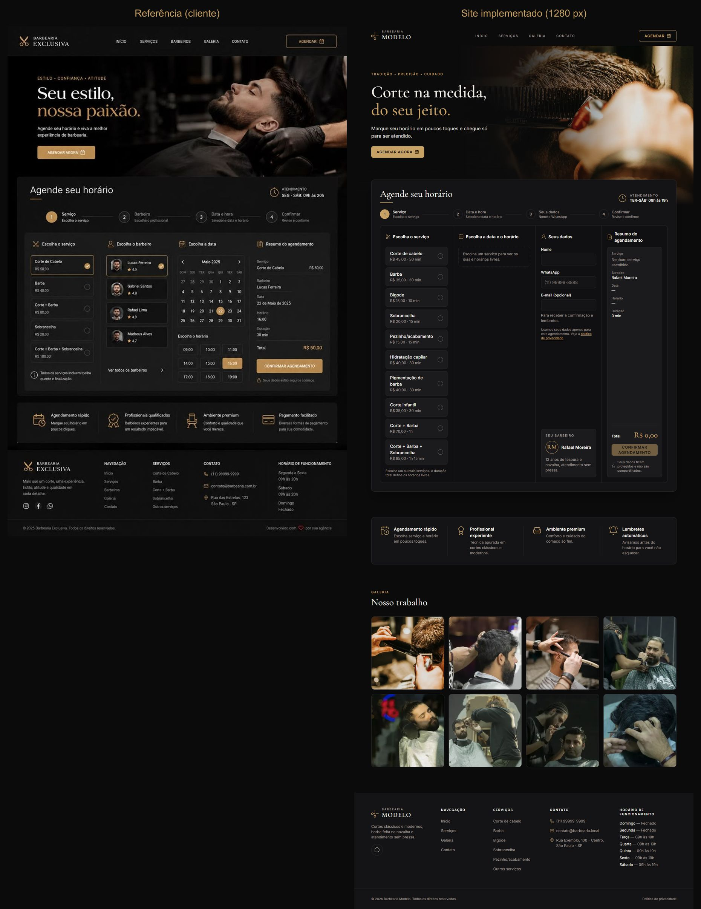

# Comparativo: referência × site

A referência ([`referencia.jpeg`](./referencia.jpeg)) foi usada como guia de **estilo e composição**. O site mantém a mesma sensação (escuro, dourado, serifada, painel de agendamento em colunas logo abaixo do hero), mas com conteúdo, marca e fotos próprios.

## O que foi mantido

| Elemento | Na referência | No site |
|---|---|---|
| Paleta | preto, grafite, dourado envelhecido | mesmos tons como tokens (`docs/design/identidade.md`) |
| Tipografia | serifada nos títulos, sans no texto, eyebrow dourado espaçado | Cormorant Garamond + Inter, eyebrow 12 px com `tracking 0.2em` |
| Cabeçalho | marca à esquerda, menu central em caixa alta, botão contornado "Agendar" | idem; abaixo de 1024 px, menu em tela cheia |
| Hero | texto à esquerda, foto à direita com gradiente, título em 2 linhas (2ª dourada), botão sólido | idem; no celular a foto vira fundo com gradiente vertical |
| Painel | sobreposto ao hero, título com traço dourado, horário de atendimento, stepper, 4 colunas | idem; de 1024 a 1180 px vira 3 + 1; no celular, uma etapa por tela com resumo fixo |
| Componentes | cartões com marcador, calendário com dia em círculo dourado, chips 3×N, total dourado, cadeado | `SelectableCard`, `Calendar`, `TimeChip`, resumo com total e nota de segurança |
| Diferenciais | faixa com 4 itens e divisórias | idem; 2×2 no celular |
| Rodapé | 5 colunas | idem, alimentado pelas configurações e pelo catálogo |

## Adaptações

| Tema | Referência | Site | Por quê |
|---|---|---|---|
| **Barbeiro** | etapa "Escolha o barbeiro" com 4 profissionais, fotos e notas | coluna "Seus dados" com o cartão informativo "Seu barbeiro" (foto ou iniciais, nome, frase), sem seleção nem notas | a barbearia tem um único barbeiro |
| **Stepper** | Serviço → Barbeiro → Data e hora → Confirmar | Serviço → Data e hora → Seus dados → Confirmar | segue o fluxo real (sem login, nome e WhatsApp) |
| **Diferencial** | "Pagamento facilitado" | "Lembretes automáticos" | não há pagamento online; lembretes por e-mail e push existem |
| **Textos** | slogan, títulos e descrições da referência | textos próprios, editáveis no painel (Configurações › Página inicial) | não copiar textos |
| **Marca** | wordmark "Barbearia Exclusiva" com tesoura | nome configurado da barbearia em serifada caixa alta (duas linhas se tiver 2+ palavras) e tesoura do lucide | não copiar marca |
| **Fotos** | foto do hero da referência | fotos com licença livre (veja `public/CREDITS.md`) até haver fotos reais | licença de uso |
| **Galeria** | item no menu, sem seção visível no recorte | seção "Nosso trabalho" com 8 fotos e lightbox | pedido do cliente |
| **Rodapé** | "Desenvolvido com ♥ por sua agência" | link da política de privacidade | LGPD; sem créditos de agência |
| **Menu** | item "Barbeiros" | sem esse item | um único barbeiro |

## Verificação

- Regressão visual: `e2e/visual.spec.ts` compara a home e o painel em 360, 768 e 1280 px (`toHaveScreenshot`, tolerância de 0,2%). Depois de uma mudança visual intencional, atualizar com `npx playwright test e2e/visual.spec.ts --project=desktop --update-snapshots`.
- Contraste: os tokens têm teste automatizado (`lib/design-tokens.test.ts`), e o texto do hero sobre a foto é medido pixel a pixel em `e2e/home.spec.ts`.
- Lighthouse mobile da home (build de produção local, 9/11/2026):
  - Acessibilidade, boas práticas e SEO: 100.
  - Desempenho: 0,92 no modo simulado padrão.
  - LCP com throttling aplicado (`--throttling-method=devtools`, 4G lento e CPU 4× mais lenta): **2,1 s**.
  - LCP no modo simulado: 3,1 s. Neste ambiente, até `/privacidade`, que é só texto, dá 2,9 s nesse modo, então a diferença vem da base comum (framework e fontes), não do hero.
